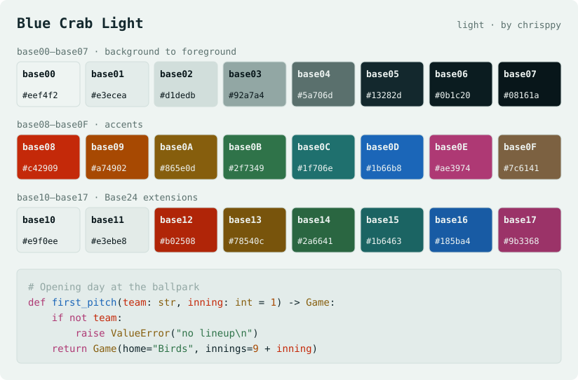

<!--
SPDX-FileCopyrightText: 2026 Chris Palmer <chris@red-oxide.org>
SPDX-License-Identifier: MIT
-->

## Blue Crab Light

The light counterpart of [Blue Crab](./blue-crab.md): pale sea foam for the
background and deep bay for the text, with crab teal, claw orange and Maryland
red and gold deepened. Every accent reaches at least 4.5:1 contrast on both the
background and the panels (lowest: 5.14:1 and 4.76:1).

| Slot | Color | Hex | Used for |
| -------- | ----------------------- | -------- | ---------------------------- |
| `base00` | Sea foam | `eef4f2` | Background |
| `base01` | Pale foam | `e3ecea` | Panels, secondary background |
| `base02` | Mist | `d1dedb` | Selection |
| `base03` | Murky teal | `92a7a4` | Comments, inactive elements |
| `base04` | Deep teal | `5a706d` | Muted foreground |
| `base05` | Deep bay | `13282d` | Foreground |
| `base06` | Deep bay | `0b1c20` | Bright foreground |
| `base07` | Deep bay | `08161a` | Maximum contrast |
| `base08` | Deep Maryland red | `c42909` | Variables, errors |
| `base09` | Deep claw orange | `a74902` | Numbers, constants |
| `base0A` | Deep Maryland gold | `865e0d` | Classes, warnings |
| `base0B` | Deep bay grass | `2f7349` | Strings, success |
| `base0C` | Deep crab teal | `1f706e` | Support, escapes |
| `base0D` | Deep Chesapeake blue | `1b66b8` | Functions, links |
| `base0E` | Deep oyster pink | `ae3974` | Keywords |
| `base0F` | Deep crab spice | `7c6141` | Deprecated, embedded |
| `base10` | Pale foam | `e9f0ee` | Darker background |
| `base11` | Pale foam | `e3ebe8` | Darkest background |
| `base12` | Intense Maryland red | `b02508` | Bright red |
| `base13` | Intense Maryland gold | `78540c` | Bright yellow |
| `base14` | Intense bay grass | `2a6641` | Bright green |
| `base15` | Intense crab teal | `1b6463` | Bright cyan |
| `base16` | Intense Chesapeake blue | `185ba4` | Bright blue |
| `base17` | Intense oyster pink | `9b3368` | Bright magenta |

For the dark variant, see [Blue Crab](./blue-crab.md).
