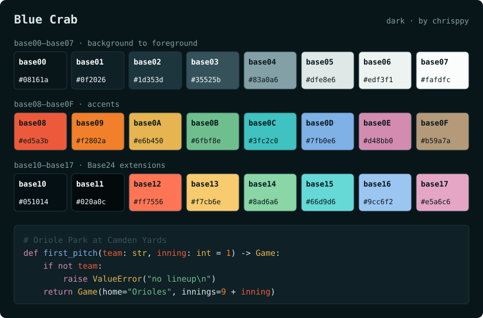

<!--
SPDX-FileCopyrightText: 2026 Chris Palmer <chris@red-oxide.org>
SPDX-License-Identifier: MIT
-->

## Blue Crab

A dark theme for the Chesapeake Bay: a teal crab with orange claws waving a
Maryland flag. The background is deep bay water, crab teal marks support and
escapes, and Maryland flag red and gold mark errors and warnings. Every accent
reaches at least 4.5:1 contrast on both the background and the panels (lowest:
5.37:1 and 4.88:1).

| Slot | Color | Hex | Used for |
| -------- | ---------------------- | -------- | ---------------------------- |
| `base00` | Deep bay | `08161a` | Background |
| `base01` | Deep bay | `0f2026` | Panels, secondary background |
| `base02` | Bay teal | `1d353d` | Selection |
| `base03` | Murky teal | `35525b` | Comments, inactive elements |
| `base04` | Sea mist | `83a0a6` | Muted foreground |
| `base05` | Foam white | `dfe8e6` | Foreground |
| `base06` | Bright foam | `edf3f1` | Bright foreground |
| `base07` | White | `fafdfc` | Maximum contrast |
| `base08` | Maryland red | `ed5a3b` | Variables, errors |
| `base09` | Claw orange | `f2802a` | Numbers, constants |
| `base0A` | Maryland gold | `e6b450` | Classes, warnings |
| `base0B` | Bay grass | `6fbf8e` | Strings, success |
| `base0C` | Crab teal | `3fc2c0` | Support, escapes |
| `base0D` | Chesapeake blue | `7fb0e6` | Functions, links |
| `base0E` | Oyster pink | `d48bb0` | Keywords |
| `base0F` | Crab spice | `b59a7a` | Deprecated, embedded |
| `base10` | Deep bay | `051014` | Darker background |
| `base11` | Deep bay | `020a0c` | Darkest background |
| `base12` | Bright Maryland red | `ff7556` | Bright red |
| `base13` | Bright Maryland gold | `f7cb6e` | Bright yellow |
| `base14` | Bright bay grass | `8ad6a6` | Bright green |
| `base15` | Bright crab teal | `66d9d6` | Bright cyan |
| `base16` | Bright Chesapeake blue | `9cc6f2` | Bright blue |
| `base17` | Bright oyster pink | `e5a6c6` | Bright magenta |

For a light variant, see [Blue Crab Light](./blue-crab-light.md).
