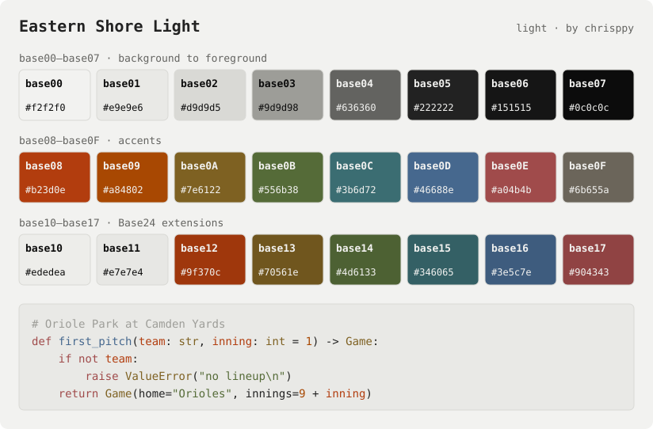

<!--
SPDX-FileCopyrightText: 2026 Chris Palmer <chris@red-oxide.org>
SPDX-License-Identifier: MIT
-->

## Eastern Shore Light

The light counterpart of [Eastern Shore](./eastern-shore.md): silver white for
the background and charcoal for the text, with the orange and shore colors
deepened. Every accent reaches at least 4.5:1 contrast on both the background
and the panels (lowest: 5.15:1 and 4.75:1).

| Slot | Color | Hex | Used for |
| -------- | ------------------- | -------- | ---------------------------- |
| `base00` | Silver white | `f2f2f0` | Background |
| `base01` | Light silver | `e9e9e6` | Panels, secondary background |
| `base02` | Silver | `d9d9d5` | Selection |
| `base03` | Gray | `9d9d98` | Comments, inactive elements |
| `base04` | Dark gray | `636360` | Muted foreground |
| `base05` | Charcoal | `222222` | Foreground |
| `base06` | Black | `151515` | Bright foreground |
| `base07` | Black | `0c0c0c` | Maximum contrast |
| `base08` | Deep orange | `b23d0e` | Variables, errors |
| `base09` | Deep amber | `a84802` | Numbers, constants |
| `base0A` | Deep beach sand | `7e6122` | Classes, warnings |
| `base0B` | Deep marsh grass | `556b38` | Strings, success |
| `base0C` | Deep bay water | `3b6d72` | Support, escapes |
| `base0D` | Deep shore sky | `46688e` | Functions, links |
| `base0E` | Deep sunset pink | `a04b4b` | Keywords |
| `base0F` | Deep driftwood | `6b655a` | Deprecated, embedded |
| `base10` | Light silver | `ededea` | Darker background |
| `base11` | Light silver | `e7e7e4` | Darkest background |
| `base12` | Intense orange | `9f370c` | Bright red |
| `base13` | Intense sand | `70561e` | Bright yellow |
| `base14` | Intense marsh grass | `4d6133` | Bright green |
| `base15` | Intense bay water | `346065` | Bright cyan |
| `base16` | Intense shore sky | `3e5c7e` | Bright blue |
| `base17` | Intense sunset pink | `904343` | Bright magenta |

For the dark variant, see [Eastern Shore](./eastern-shore.md).
