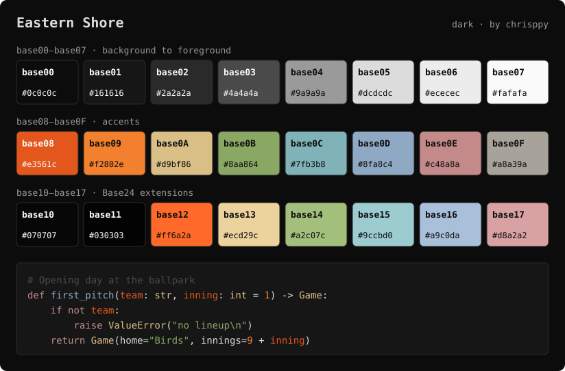

## Eastern Shore

A dark theme for Salisbury and the Eastern Shore of Maryland: black, silver and
orange, with the rest of the accents taken from the shore itself: beach sand,
marsh grass, bay water and driftwood. Every accent reaches at least 4.5:1
contrast on both the background and the panels (lowest: 5.23:1 and 4.84:1).

| Slot | Color | Hex | Used for |
| -------- | ------------------ | -------- | ---------------------------- |
| `base00` | Black | `0c0c0c` | Background |
| `base01` | Black | `161616` | Panels, secondary background |
| `base02` | Dark gray | `2a2a2a` | Selection |
| `base03` | Gray | `4a4a4a` | Comments, inactive elements |
| `base04` | Silver | `9a9a9a` | Muted foreground |
| `base05` | Light silver | `dcdcdc` | Foreground |
| `base06` | Bright silver | `ececec` | Bright foreground |
| `base07` | White | `fafafa` | Maximum contrast |
| `base08` | Orange | `e3561c` | Variables, errors |
| `base09` | Light orange | `f2802e` | Numbers, constants |
| `base0A` | Beach sand | `d9bf86` | Classes, warnings |
| `base0B` | Marsh grass | `8aa864` | Strings, success |
| `base0C` | Bay water | `7fb3b8` | Support, escapes |
| `base0D` | Shore sky | `8fa8c4` | Functions, links |
| `base0E` | Sunset pink | `c48a8a` | Keywords |
| `base0F` | Driftwood | `a8a39a` | Deprecated, embedded |
| `base10` | Black | `070707` | Darker background |
| `base11` | Black | `030303` | Darkest background |
| `base12` | Bright orange | `ff6a2a` | Bright red |
| `base13` | Bright sand | `ecd29c` | Bright yellow |
| `base14` | Bright marsh grass | `a2c07c` | Bright green |
| `base15` | Bright bay water | `9ccbd0` | Bright cyan |
| `base16` | Bright shore sky | `a9c0da` | Bright blue |
| `base17` | Bright sunset pink | `d8a2a2` | Bright magenta |

For a light variant, see [Eastern Shore Light](./eastern-shore-light.md).
