## Gallery

Every bundled theme at a glance. Select one for its full palette.

<table>
<tr>
<td align="center" valign="top">
<a href="./birdland.md">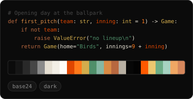</a> 
<a href="./birdland.md"><strong>Birdland</strong></a>
</td>
<td align="center" valign="top">
<a href="./birdland-light.md">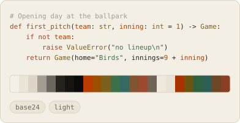</a> 
<a href="./birdland-light.md"><strong>Birdland Light</strong></a>
</td>
</tr>
<tr>
<td align="center" valign="top">
<a href="./blue-crab.md">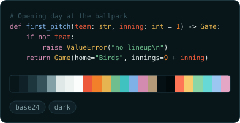</a> 
<a href="./blue-crab.md"><strong>Blue Crab</strong></a>
</td>
<td align="center" valign="top">
<a href="./blue-crab-light.md">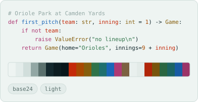</a> 
<a href="./blue-crab-light.md"><strong>Blue Crab Light</strong></a>
</td>
</tr>
<tr>
<td align="center" valign="top">
<a href="./eastern-shore.md">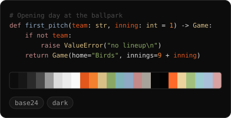</a> 
<a href="./eastern-shore.md"><strong>Eastern Shore</strong></a>
</td>
<td align="center" valign="top">
<a href="./eastern-shore-light.md">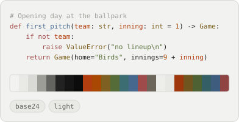</a> 
<a href="./eastern-shore-light.md"><strong>Eastern Shore Light</strong></a>
</td>
</tr>
<tr>
<td align="center" valign="top">
<a href="./harbor.md">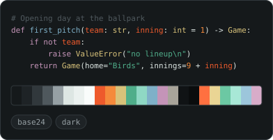</a> 
<a href="./harbor.md"><strong>Harbor</strong></a>
</td>
<td align="center" valign="top">
<a href="./harbor-light.md">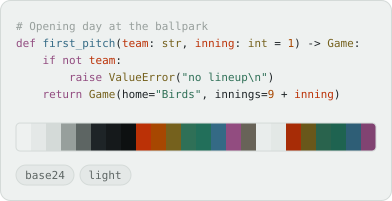</a> 
<a href="./harbor-light.md"><strong>Harbor Light</strong></a>
</td>
</tr>
<tr>
<td align="center" valign="top">
<a href="./red-oxide.md">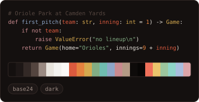</a> 
<a href="./red-oxide.md"><strong>Red Oxide</strong></a>
</td>
<td align="center" valign="top">
<a href="./red-oxide-light.md">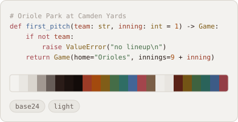</a> 
<a href="./red-oxide-light.md"><strong>Red Oxide Light</strong></a>
</td>
</tr>
<tr>
<td align="center" valign="top">
<a href="./spangled.md">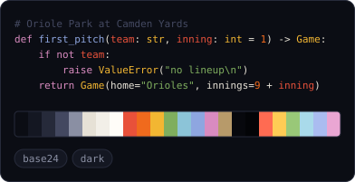</a> 
<a href="./spangled.md"><strong>Spangled</strong></a>
</td>
<td align="center" valign="top">
<a href="./spangled-light.md">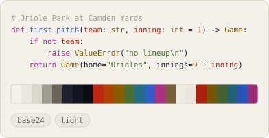</a> 
<a href="./spangled-light.md"><strong>Spangled Light</strong></a>
</td>
</tr>
</table>

This page is generated: run
`nix eval --raw .#lib.base24.gallery > docs/gallery.md` after adding a theme.
