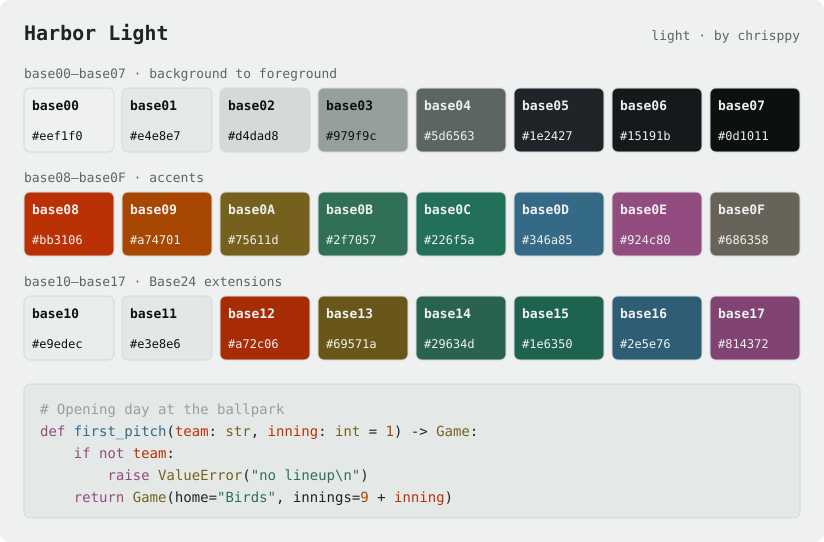

<!--
SPDX-FileCopyrightText: 2026 Chris Palmer <chris@red-oxide.org>
SPDX-License-Identifier: MIT
-->

## Harbor Light

The light counterpart of [Harbor](./harbor.md): harbor fog for the background
and battleship gray for the text, with sea foam, tidal green and signal orange
deepened. Every accent reaches at least 4.5:1 contrast on both the background
and the panels (lowest: 5.17:1 and 4.75:1).

| Slot | Color | Hex | Used for |
| -------- | --------------------- | -------- | ---------------------------- |
| `base00` | Fog | `eef1f0` | Background |
| `base01` | Light fog | `e4e8e7` | Panels, secondary background |
| `base02` | Haze | `d4dad8` | Selection |
| `base03` | Hull gray | `979f9c` | Comments, inactive elements |
| `base04` | Deck gray | `5d6563` | Muted foreground |
| `base05` | Battleship gray | `1e2427` | Foreground |
| `base06` | Battleship gray | `15191b` | Bright foreground |
| `base07` | Battleship gray | `0d1011` | Maximum contrast |
| `base08` | Deep signal orange | `bb3106` | Variables, errors |
| `base09` | Deep buoy orange | `a74701` | Numbers, constants |
| `base0A` | Deep brass | `75611d` | Classes, warnings |
| `base0B` | Deep tidal green | `2f7057` | Strings, success |
| `base0C` | Deep sea foam | `226f5a` | Support, escapes |
| `base0D` | Deep harbor blue | `346a85` | Functions, links |
| `base0E` | Deep coral | `924c80` | Keywords |
| `base0F` | Deep rope | `686358` | Deprecated, embedded |
| `base10` | Light fog | `e9edec` | Darker background |
| `base11` | Light fog | `e3e8e6` | Darkest background |
| `base12` | Intense signal orange | `a72c06` | Bright red |
| `base13` | Intense brass | `69571a` | Bright yellow |
| `base14` | Intense tidal green | `29634d` | Bright green |
| `base15` | Intense sea foam | `1e6350` | Bright cyan |
| `base16` | Intense harbor blue | `2e5e76` | Bright blue |
| `base17` | Intense coral | `814372` | Bright magenta |

For the dark variant, see [Harbor](./harbor.md).
