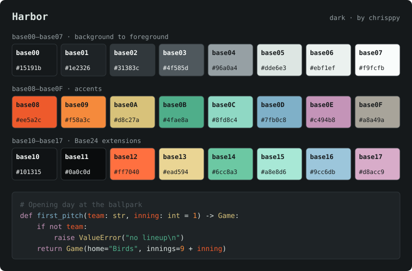

## Harbor

A dark theme for Norfolk, Virginia, and its naval harbor: battleship gray for
the background, sea foam and tidal green for support and strings, and signal
orange for errors, with brass, harbor blue and coral filling the remaining
slots. Every accent reaches at least 4.5:1 contrast on both the background and
the panels (lowest: 5.17:1 and 4.63:1).

| Slot | Color | Hex | Used for |
| -------- | -------------------- | -------- | ---------------------------- |
| `base00` | Battleship gray | `15191b` | Background |
| `base01` | Battleship gray | `1e2326` | Panels, secondary background |
| `base02` | Deck gray | `31383c` | Selection |
| `base03` | Hull gray | `4f585d` | Comments, inactive elements |
| `base04` | Fog gray | `96a0a4` | Muted foreground |
| `base05` | Sea spray | `dde6e3` | Foreground |
| `base06` | Bright spray | `ebf1ef` | Bright foreground |
| `base07` | White | `f9fcfb` | Maximum contrast |
| `base08` | Signal orange | `ee5a2c` | Variables, errors |
| `base09` | Buoy orange | `f58a3c` | Numbers, constants |
| `base0A` | Brass | `d8c27a` | Classes, warnings |
| `base0B` | Tidal green | `4fae8a` | Strings, success |
| `base0C` | Sea foam | `8fd8c4` | Support, escapes |
| `base0D` | Harbor blue | `7fb0c8` | Functions, links |
| `base0E` | Coral | `c494b8` | Keywords |
| `base0F` | Rope | `a8a49a` | Deprecated, embedded |
| `base10` | Battleship gray | `101315` | Darker background |
| `base11` | Battleship gray | `0a0c0d` | Darkest background |
| `base12` | Bright signal orange | `ff7040` | Bright red |
| `base13` | Bright brass | `ead594` | Bright yellow |
| `base14` | Bright tidal green | `6cc8a3` | Bright green |
| `base15` | Bright sea foam | `a8e8d6` | Bright cyan |
| `base16` | Bright harbor blue | `9cc6db` | Bright blue |
| `base17` | Bright coral | `d8acc9` | Bright magenta |

For a light variant, see [Harbor Light](./harbor-light.md).
