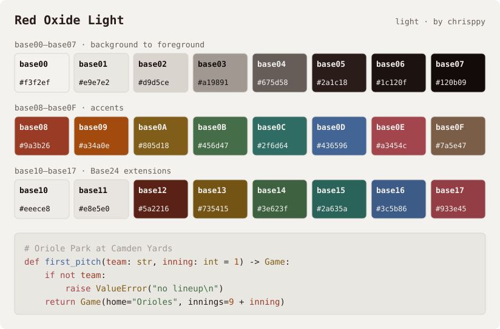

## Red Oxide Light

The light counterpart of [Red Oxide](./red-oxide.md), in the logo's own colors:
plate white (`f3f2ef`) for the background, oxide red (`9a3b26`) for variables
and errors, and dark oxide (`5a2216`) for bright red. The other accents are
deepened rust, brass, patina and blued steel. Every accent reaches at least
4.5:1 contrast on both the background and the panels (lowest: 5.29:1 and
4.80:1).

| Slot | Color | Hex | Used for |
| -------- | ------------------- | -------- | ---------------------------- |
| `base00` | Plate white | `f3f2ef` | Background |
| `base01` | Primer white | `e9e7e2` | Panels, secondary background |
| `base02` | Light scale | `d9d5ce` | Selection |
| `base03` | Weathered gray | `a19891` | Comments, inactive elements |
| `base04` | Corroded gray | `675d58` | Muted foreground |
| `base05` | Dark oxide | `2a1c18` | Foreground |
| `base06` | Dark oxide | `1c120f` | Bright foreground |
| `base07` | Dark oxide | `120b09` | Maximum contrast |
| `base08` | Oxide red (logo) | `9a3b26` | Variables, errors |
| `base09` | Deep rust orange | `a34a0e` | Numbers, constants |
| `base0A` | Deep brass | `805d18` | Classes, warnings |
| `base0B` | Deep patina green | `456d47` | Strings, success |
| `base0C` | Deep verdigris | `2f6d64` | Support, escapes |
| `base0D` | Deep blued steel | `436596` | Functions, links |
| `base0E` | Deep rose rust | `a3454c` | Keywords |
| `base0F` | Deep mill scale | `7a5e47` | Deprecated, embedded |
| `base10` | Primer white | `eeece8` | Darker background |
| `base11` | Primer white | `e8e5e0` | Darkest background |
| `base12` | Dark oxide (logo) | `5a2216` | Bright red |
| `base13` | Intense brass | `735415` | Bright yellow |
| `base14` | Intense patina | `3e623f` | Bright green |
| `base15` | Intense verdigris | `2a635a` | Bright cyan |
| `base16` | Intense blued steel | `3c5b86` | Bright blue |
| `base17` | Intense rose rust | `933e45` | Bright magenta |

For the dark variant, see [Red Oxide](./red-oxide.md).
