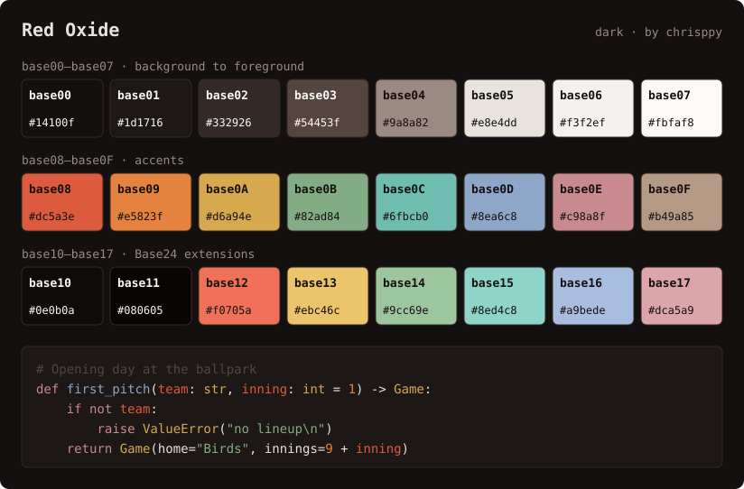

<!--
SPDX-FileCopyrightText: 2026 Chris Palmer <chris@red-oxide.org>
SPDX-License-Identifier: MIT
-->

## Red Oxide

A dark theme for red-oxide, whose logo is a rusted steel home plate. Dark rusted
steel for the background and plate white for the text, with oxide red and rust
orange for errors and constants, and brass, patina green, verdigris and blued
steel for the rest. Every accent reaches at least 4.5:1 contrast on both the
background and the panels (lowest: 5.02:1 and 4.70:1).

| Slot | Color | Hex | Used for |
| -------- | ------------------ | -------- | ---------------------------- |
| `base00` | Rusted steel | `14100f` | Background |
| `base01` | Rusted steel | `1d1716` | Panels, secondary background |
| `base02` | Scale | `332926` | Selection |
| `base03` | Corroded gray | `54453f` | Comments, inactive elements |
| `base04` | Weathered steel | `9a8a82` | Muted foreground |
| `base05` | Plate white | `e8e4dd` | Foreground |
| `base06` | Plate white | `f3f2ef` | Bright foreground |
| `base07` | White | `fbfaf8` | Maximum contrast |
| `base08` | Oxide red | `dc5a3e` | Variables, errors |
| `base09` | Rust orange | `e5823f` | Numbers, constants |
| `base0A` | Brass | `d6a94e` | Classes, warnings |
| `base0B` | Patina green | `82ad84` | Strings, success |
| `base0C` | Verdigris | `6fbcb0` | Support, escapes |
| `base0D` | Blued steel | `8ea6c8` | Functions, links |
| `base0E` | Rose rust | `c98a8f` | Keywords |
| `base0F` | Mill scale | `b49a85` | Deprecated, embedded |
| `base10` | Rusted steel | `0e0b0a` | Darker background |
| `base11` | Rusted steel | `080605` | Darkest background |
| `base12` | Bright oxide red | `f0705a` | Bright red |
| `base13` | Bright brass | `ebc46c` | Bright yellow |
| `base14` | Bright patina | `9cc69e` | Bright green |
| `base15` | Bright verdigris | `8ed4c8` | Bright cyan |
| `base16` | Bright blued steel | `a9bede` | Bright blue |
| `base17` | Bright rose rust | `dca5a9` | Bright magenta |

For a light variant, see [Red Oxide Light](./red-oxide-light.md).
