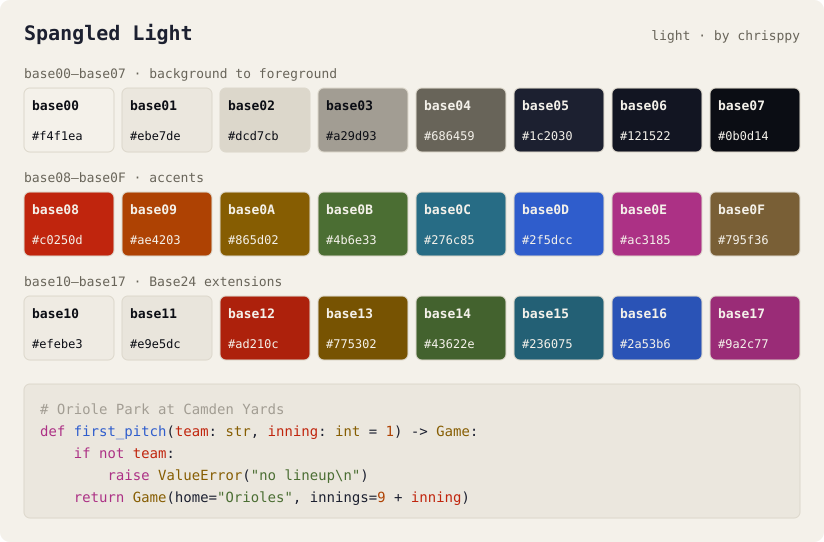

## Spangled Light

The light counterpart of [Spangled](./spangled.md): cream for the background and
night navy for the text, with the orange, firework red and gold deepened. Every
accent reaches at least 4.5:1 contrast on both the background and the panels
(lowest: 5.20:1 and 4.75:1).

| Slot | Color | Hex | Used for |
| -------- | ---------------------- | -------- | ---------------------------- |
| `base00` | Cream | `f4f1ea` | Background |
| `base01` | Darker cream | `ebe7de` | Panels, secondary background |
| `base02` | Tan | `dcd7cb` | Selection |
| `base03` | Warm gray | `a29d93` | Comments, inactive elements |
| `base04` | Slate | `686459` | Muted foreground |
| `base05` | Night navy | `1c2030` | Foreground |
| `base06` | Night navy | `121522` | Bright foreground |
| `base07` | Night navy | `0b0d14` | Maximum contrast |
| `base08` | Deep firework red | `c0250d` | Variables, errors |
| `base09` | Deep ballpark orange | `ae4203` | Numbers, constants |
| `base0A` | Deep firework gold | `865d02` | Classes, warnings |
| `base0B` | Deep outfield green | `4b6e33` | Strings, success |
| `base0C` | Deep star blue | `276c85` | Support, escapes |
| `base0D` | Deep evening blue | `2f5dcc` | Functions, links |
| `base0E` | Deep firework pink | `ac3185` | Keywords |
| `base0F` | Deep brass key | `795f36` | Deprecated, embedded |
| `base10` | Darker cream | `efebe3` | Darker background |
| `base11` | Darkest cream | `e9e5dc` | Darkest background |
| `base12` | Intense firework red | `ad210c` | Bright red |
| `base13` | Intense firework gold | `775302` | Bright yellow |
| `base14` | Intense outfield green | `43622e` | Bright green |
| `base15` | Intense star blue | `236075` | Bright cyan |
| `base16` | Intense evening blue | `2a53b6` | Bright blue |
| `base17` | Intense firework pink | `9a2c77` | Bright magenta |

For the dark variant, see [Spangled](./spangled.md).
