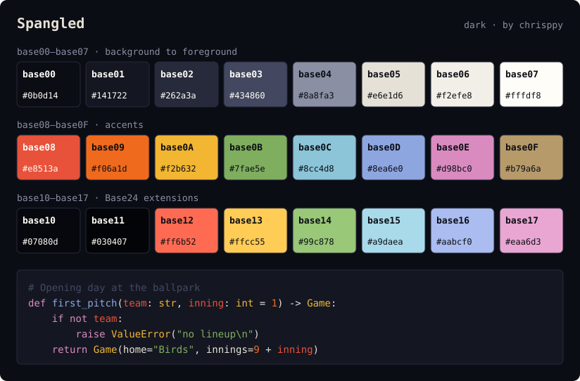

## Spangled

A dark theme for Frederick, Maryland, the hometown of Francis Scott Key: orange
and black, with the red and gold of fireworks bursting over a night-sky navy
background. Orange marks numbers and constants, firework red errors, and
firework gold warnings. Every accent reaches at least 4.5:1 contrast on both the
background and the panels (lowest: 5.24:1 and 4.82:1).

| Slot | Color | Hex | Used for |
| -------- | --------------------- | -------- | ---------------------------- |
| `base00` | Night navy | `0b0d14` | Background |
| `base01` | Night navy | `141722` | Panels, secondary background |
| `base02` | Dusk blue | `262a3a` | Selection |
| `base03` | Slate | `434860` | Comments, inactive elements |
| `base04` | Gray blue | `8a8fa3` | Muted foreground |
| `base05` | Cream | `e6e1d6` | Foreground |
| `base06` | Warm white | `f2efe8` | Bright foreground |
| `base07` | White | `fffdf8` | Maximum contrast |
| `base08` | Firework red | `e8513a` | Variables, errors |
| `base09` | Ballpark orange | `f06a1d` | Numbers, constants |
| `base0A` | Firework gold | `f2b632` | Classes, warnings |
| `base0B` | Outfield green | `7fae5e` | Strings, success |
| `base0C` | Star white blue | `8cc4d8` | Support, escapes |
| `base0D` | Evening blue | `8ea6e0` | Functions, links |
| `base0E` | Firework pink | `d98bc0` | Keywords |
| `base0F` | Brass key | `b79a6a` | Deprecated, embedded |
| `base10` | Night navy | `07080d` | Darker background |
| `base11` | Night navy | `030407` | Darkest background |
| `base12` | Bright firework red | `ff6b52` | Bright red |
| `base13` | Bright firework gold | `ffcc55` | Bright yellow |
| `base14` | Bright outfield green | `99c878` | Bright green |
| `base15` | Bright star blue | `a9daea` | Bright cyan |
| `base16` | Bright evening blue | `aabcf0` | Bright blue |
| `base17` | Bright firework pink | `eaa6d3` | Bright magenta |

For a light variant, see [Spangled Light](./spangled-light.md).
